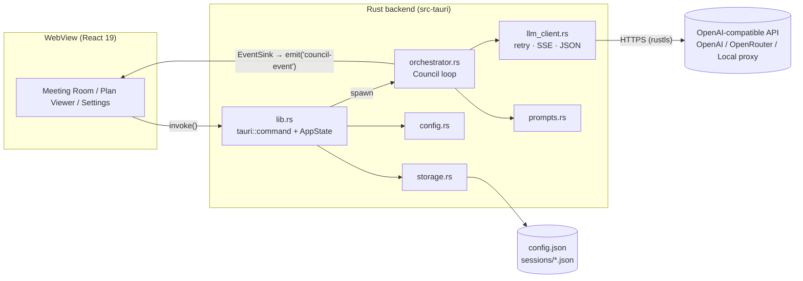
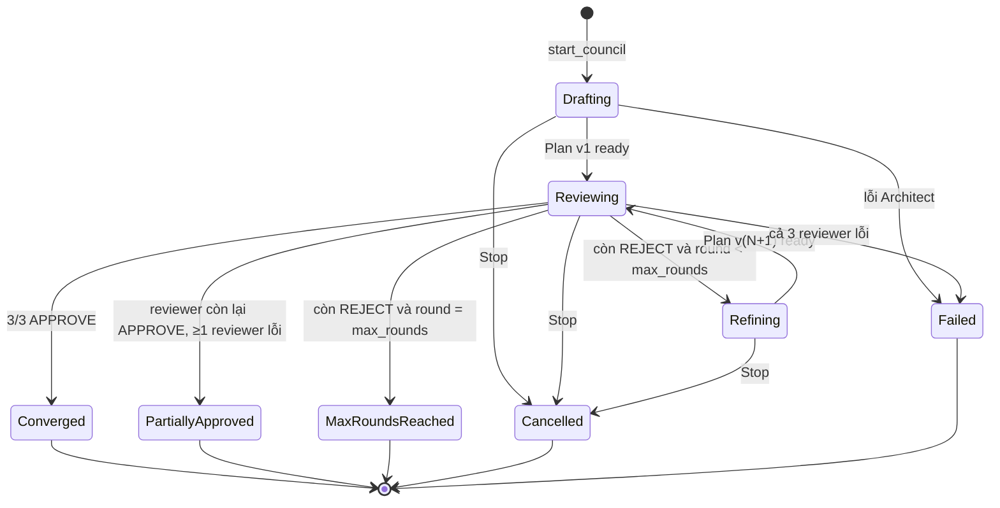

# PlanCouncil — Tài liệu Kiến trúc Kỹ thuật

> Phiên bản: 0.1.0 · Config schema v3 · Role động + phòng ban + phòng họp pixel-art

## 1. Tổng quan

PlanCouncil là desktop app (Tauri v2, chạy trên Ubuntu và Windows 11) mô phỏng một **công ty họp duyệt kế hoạch**:

- **Vai trò (role)** do người dùng quản lý: thêm/sửa/xoá tự do. Mỗi role có persona (`instructions`), cấp bậc, màu/icon và **model riêng** (provider + model + temperature). Danh mục mặc định gồm ~30 role từ C-Level (CEO, CTO, CPO, CFO, COO, CISO) → Head/Manager (PM, BA, UA, Monetization, LiveOps) → Lead (Architect, Tech Lead, QA Lead) → Engineer (Backend, Frontend, Mobile, DevOps/SRE, DBA, Data, ML, Performance, Security) → Staff (QA, QC, Tester, UI/UX, Data Analyst, Legal). Định nghĩa ở `src-tauri/src/roster.rs`.
- **Phòng ban**: 1 trưởng phòng (viết plan của phòng) + thành viên phản biện + số vòng nội bộ. Mặc định có 8 phòng: Ban Giám đốc, Product & Design, Engineering, Platform & SRE, QA & QC, Security & Compliance, Growth (UA & Monetization), Data & AI.
- **Cuộc họp chính**: 1 chủ trì + tối đa 12 reviewer + các phòng ban tham gia (chọn lại được cho từng phiên).

Luồng một phiên:

1. Chủ trì **giao việc** cho từng phòng ban (JSON `assignments`; lỗi → phòng nhận nhiệm vụ mặc định theo sứ mệnh).
2. Các phòng ban **họp nội bộ song song** (maker–checker như dưới), một phòng lỗi không làm hỏng phiên.
3. Chủ trì viết **plan tổng** từ yêu cầu + báo cáo các phòng ban (`<department_reports>`).
4. Reviewer cuộc họp chính phản biện song song cho tới khi cùng `APPROVE` hoặc hết `max_rounds`.

Số request LLM đồng thời bị giới hạn bằng semaphore (`max_parallel_calls`, mặc định 6).

### 1.1 Token, công cụ, bối cảnh công ty

| Tính năng | Cách làm |
|---|---|
| **Đếm token** | Đọc `usage` của mọi response (stream gửi `stream_options.include_usage`, provider từ chối → tự bỏ). Thiếu `usage` → ước lượng ~3 ký tự/token và đánh dấu `estimated`. Event `usage_updated` sau mỗi lần gọi; `SessionRecord.usage` lưu tổng + theo role / nơi họp / loại việc (`assign`, `research`, `plan`, `review`). UI: bộ đếm trên header, tab **Token** trong Plan Viewer, cột token trong Lịch sử. |
| **Workspace** (`src-tauri/src/tools.rs`) | Thư mục được cấp quyền chọn bằng hộp thoại từ Rust. Chỉ đọc; `canonicalize` + `starts_with(root)` chặn `..` và symlink ra ngoài; bỏ qua `node_modules/.git/target/dist…`; chặn file bí mật (`.env*` trừ `.example`, `*.pem`, `*.key`, `id_rsa*`, `.npmrc`…); bỏ file nhị phân, giới hạn 1 MB/file đọc, 400 dòng/lần. Tổng quan workspace (cây 2 cấp + manifest + README, ≤ 14k ký tự) được đưa vào bản nháp đầu của người viết plan. |
| **Web** | DuckDuckGo HTML (không key) / Tavily / Brave / SearXNG. `fetch_url` chặn SSRF: chỉ http(s), mọi IP phân giải phải công cộng (chặn loopback, RFC1918, link-local 169.254, CGNAT 100.64/10, ULA…), redirect được kiểm tra lại từng bước. Rủi ro còn lại: DNS rebinding giữa lúc kiểm tra và lúc kết nối. |
| **Nghiên cứu** | Vòng OpenAI function calling (`list_files`, `read_file`, `search_code`, `web_search`, `fetch_url`), tối đa `max_tool_steps` lượt; kết quả là ghi chú có trích nguồn, chèn vào prompt dưới `<research_notes>`. Chính sách `tool_policy`: `authors` (mặc định — chủ trì + trưởng phòng, 1 lần trước bản nháp, dùng lại khi chỉnh sửa), `all` (reviewer cũng nghiên cứu ở round 1), `off`. Model trả 400/404/422/501 cho `tools` → đánh dấu không hỗ trợ, bỏ qua, phiên vẫn chạy. |
| **Bối cảnh công ty** | `company_context.text` (≤ 20k ký tự) chèn vào system prompt của MỌI role dưới `<company_context>` + chính sách bắt buộc tuân thủ (reviewer coi vi phạm là critical). Tắt cho 1 phiên → prompt nói rõ được nghĩ vượt giới hạn. Mặc định bật (`enabled_by_default`). |

Tuỳ chọn mỗi phiên (`start_council.options`): `workspace_id`, `web_search`, `company_context`, `plan_depth`, `chair_id`/`reviewer_ids` (thành phần đã duyệt), `auto_staff`; lưu vào `SessionRecord.options`.

### 1.2 Chống "vẽ quá đà" và tiết kiệm token

| Cơ chế | Cách làm |
|---|---|
| **Mức độ plan** (`meeting.plan_depth`) | `mvp` (≤ 900 từ, không capacity/SLO, ≤ 3 mốc) · `standard` (mặc định: số liệu chỉ khi yêu cầu cần) · `enterprise` (production-grade). Đổi được cho từng phiên. |
| **Kỷ luật phạm vi** | Giao việc chỉ được *chia nhỏ* yêu cầu, giả định phải ghi rõ. Plan kết thúc bằng `### Out of scope`. Reviewer chỉ REJECT vì vấn đề *trong phạm vi*; ý tưởng mở rộng vào `out_of_scope`. Khi chỉnh sửa ưu tiên gọt bớt. |
| **Vòng 1 nghiêm** | Mặc định **tắt**. Bật thì cần ≥ 1 vấn đề cụ thể (trước là ép REJECT + ≥ 2 → reviewer phải "tìm ra" vấn đề). |
| **Docs có thể cũ** | Bước nghiên cứu được dặn đối chiếu với code; tổng quan workspace ghi ngày sửa của README/manifest. |
| **Chọn thành phần** (`meeting.staffing`) | `manual` · `suggest` (mặc định: AI đề xuất + lý do, người dùng duyệt) · `auto`. 1 lần gọi ~2–3k token đọc danh sách role 1 dòng/role. Server kiểm tra lại: role bắt buộc, `max_auto_reviewers`, `max_auto_departments`, id có thật, role đã gán model. (`src-tauri/src/staffing.rs`) |
| **Thành viên động** | Reviewer có thể `ABSTAIN` (rời họp, không tính hội tụ) hoặc đề nghị `invite` chuyên gia từ danh sách còn trống (tối đa `max_invites`/nơi họp; người được mời không chịu luật vòng 1 nghiêm). Người dùng mời / mời ra qua `invite_member` / `dismiss_member`, áp dụng từ vòng kế tiếp. |
| **Review theo section** (`meeting.section_routing`, `src-tauri/src/routing.rs`) | Người viết gắn `<!-- reviewers: id1, id2 -->` (hoặc `all`) dưới mỗi `##`/`###`. Reviewer nhận Overview + phần của mình + phần `all`; phần khác chỉ giữ tiêu đề. Plan không tag / reviewer chưa được gắn → toàn văn. Vòng sau: phần phụ trách không đổi (fingerprint bỏ qua Overview, Changelog, khoảng trắng) và lần trước APPROVE → **giữ nguyên, không gọi model**. Token tiết kiệm ghi vào `usage.saved_tokens` / `carried_reviews`. |

Mọi lời gọi LLM đều chạy trong **Rust**. Webview chỉ nhận event và gọi command, không bao giờ chạm vào API key hay network bên ngoài.

## 2. Kiến trúc thành phần



| Module | Trách nhiệm | Phụ thuộc Tauri? |
|---|---|---|
| `main.rs` | Entry point, ẩn console trên Windows release | có |
| `lib.rs` | `AppState`, 10 command, `TauriSink`, `ActiveGuard` | có |
| `orchestrator.rs` | Vòng lặp hội tụ, emit event qua trait `EventSink` | **không** |
| `llm_client.rs` | HTTP client OpenAI-compatible | không |
| `prompts.rs` | System prompt, template refine, phụ lục Open Issues | không |
| `models.rs` | Domain struct, event schema, validate review | không |
| `config.rs` | Cấu hình endpoint theo agent, che/ghép API key | không |
| `storage.rs` | Đọc/ghi file JSON (blocking, atomic) | không |

`Orchestrator` chỉ biết trait `EventSink` (Dependency Inversion), nhờ vậy toàn bộ vòng lặp được test với mock HTTP server mà không cần webview.

## 3. Luồng hội tụ (Convergence Loop)



### 3.1 Các bước trong một phiên

1. **Drafting:** Architect viết `Plan v1` với 5 section cố định: Overview, Architecture (bắt buộc có khối `mermaid`), Data Flow, Tech Stack & Schema, Edge Cases & Trade-offs.
2. **Parallel critique:** `tokio::join!` gọi 3 reviewer đồng thời trên cùng task, dùng chung connection pool. Mỗi reviewer trả JSON:
   ```json
   { "role": "...", "verdict": "APPROVE|REJECT", "summary_bubble": "≤ 15 từ",
     "critical_issues": ["..."], "suggestions": ["..."] }
   ```
3. **Convergence check:**
   - 3/3 `APPROVE` → `converged`, Final = plan hiện tại.
   - Còn `REJECT` và đã ở round cuối → `max_rounds_reached`, Final = plan hiện tại + phụ lục **⚠️ Open Issues**.
   - Còn `REJECT` → Architect viết lại toàn bộ plan `v(N+1)`, thêm section `## 6. Changelog` (bảng `# | Reviewer | Issue | Resolution | Status`).
4. Với `max_rounds = 3`, phiên tạo ra tối đa `v1`, `v2`, `v3` và `Final`.

### 3.2 Chống khen xã giao ở Round 1

Không chỉ dựa vào prompt mà kiểm tra ở server:

1. Prompt Round 1 bắt buộc `REJECT` và ≥ 2 `critical_issues`.
2. Nếu reviewer vẫn vi phạm, backend gửi thêm `ROUND_ONE_CORRECTION` để model tự review lại **1 lần**.
3. Vẫn vi phạm → ép `verdict = REJECT` và ghi `policy_override` để UI hiển thị minh bạch. Backend **không tự bịa issue**.

### 3.3 Chống vòng lặp không hội tụ

- Từ Round 2, mỗi reviewer nhận lại review cũ của chính mình (`<your_previous_review>`) và phải đối chiếu với Changelog.
- Chỉ `REJECT` nếu còn lỗi có thể gây sự cố production, mất dữ liệu, lỗ hổng bảo mật hoặc làm hỏng dự án. Góp ý nhỏ đưa vào `suggestions`.
- Architect được phép trả lời `Won't fix` kèm lý do kỹ thuật thay vì thêm độ phức tạp chỉ để chiều reviewer.

### 3.4 Xử lý lỗi từng phần

| Tình huống | Hành vi |
|---|---|
| 1–2 reviewer lỗi API (sau khi đã retry) | Emit `review_failed`, round vẫn tiếp tục với feedback của reviewer còn lại |
| Reviewer còn lại đều APPROVE nhưng có reviewer lỗi | `partially_approved`, Final có ghi chú "không review được" |
| Cả 3 reviewer lỗi | `failed` |
| Architect lỗi hoặc trả plan rỗng | `failed` |
| Người dùng bấm Stop | `cancelled`, dừng gần như tức thì (mọi await đều `select!` với `CancellationToken`) |

Dù kết thúc thế nào, `Council::run()` luôn trả về `SessionRecord` để lưu lịch sử.

## 4. IPC Contract

Định nghĩa gốc ở `src-tauri/src/models.rs` và `config.rs`, bản TypeScript tương ứng ở `src/lib/contracts.ts`.

### 4.1 Commands

Tên tham số phía JS dùng camelCase theo convention của Tauri v2.

| Command | Tham số | Trả về | Ghi chú |
|---|---|---|---|
| `get_config` | — | `AppConfig` | API key đã che (`••••abcd`) |
| `save_config` | `{ config }` | `AppConfig` | Giữ nguyên giá trị mask = giữ key cũ; `""` = xoá key |
| `start_council` | `{ prompt }` | `string` (session id) | Tối đa 50.000 ký tự; lỗi `already_running` nếu đang có phiên |
| `stop_council` | `{ sessionId }` | `boolean` | |
| `active_session` | — | `string \| null` | Dùng khi reload webview |
| `list_sessions` | `{ limit? }` | `SessionSummary[]` | Mặc định 100, tối đa 500 |
| `load_session` | `{ sessionId }` | `SessionRecord` | |
| `delete_session` | `{ sessionId }` | `boolean` | Không xoá được phiên đang chạy |
| `test_connection` | `{ agent }` | `ConnectionTestResult` | Không retry, timeout 30s |
| `list_models` | `{ providerId, baseUrl?, apiKey? }` | `ModelList` | `GET /models`, timeout 20s; cache vào config nếu dùng credential đã lưu |
| `export_markdown` | `{ content, suggestedName }` | `string \| null` | Hộp thoại lưu mở từ Rust; `null` nếu người dùng huỷ |

Lỗi trả về dạng `{ kind, message }` với `kind ∈ invalid | already_running | not_found | storage | llm | internal`.

### 4.2 Events

Kênh `council-event`, payload là `EventEnvelope = { session_id, seq, ts, type, ...fields }`. `seq` tăng liên tục trong một phiên; việc gán `seq` và emit nằm chung một critical section nên thứ tự luôn đúng kể cả khi 3 reviewer emit song song.

| `type` | Field | Ý nghĩa cho UI |
|---|---|---|
| `session_started` | `prompt, max_rounds` | Reset phòng họp |
| `agent_thinking` | `agent, round, plan_version` | Avatar phát sáng / gõ phím |
| `plan_stream_reset` | `version` | Xoá buffer của version (stream bị retry) |
| `plan_delta` | `version, delta` | Nối text vào plan đang stream (gộp mỗi 50ms / 4KB) |
| `plan_ready` | `version, markdown` | Plan hoàn chỉnh, thay toàn bộ buffer |
| `review_ready` | `round, review` | Hiện speech bubble + badge APPROVE/REJECT |
| `review_failed` | `round, agent, error` | Avatar báo lỗi |
| `round_completed` | `round, plan_version, approvals, total, converged` | Cập nhật timeline |
| `finished` | `status, final_version, final_markdown` | Mở tab Final |
| `cancelled` | `round` | |
| `failed` | `error` | |

Kênh phụ `council-session-saved` với `{ session_id, ok }` báo lịch sử đã được ghi xuống đĩa (để refresh danh sách History).

### 4.3 Trạng thái phiên (`SessionStatus`)

`running` · `converged` · `max_rounds_reached` · `partially_approved` · `cancelled` · `failed`

## 5. LLM Client

| Tính năng | Chi tiết |
|---|---|
| Endpoint | `POST {base_url}/chat/completions`; chấp nhận cả base_url đã có sẵn `/chat/completions` |
| Retry | 408, 409, 425, 429, 500, 502, 503, 504, 529, timeout, lỗi mạng. Backoff 0.5s → 8s + jitter 0–250ms, tôn trọng `Retry-After` (tối đa 30s) |
| Cancel | Mọi bước chờ (gửi request, đọc body, sleep backoff, đọc stream) đều `select!` với `CancellationToken` |
| JSON mode | Mặc định gửi `response_format: json_object`; provider trả 400/422 → tự gửi lại không có tham số này |
| Parse JSON khoan dung | Nguyên văn → bỏ `<think>…</think>` → bỏ code fence → lấy object `{…}` cân bằng đầu tiên. Fail → 1 lần "repair prompt" kèm lỗi cụ thể |
| Đọc review khoan dung | `verdict` không phân biệt hoa thường (`approved`, ` Reject `); danh sách nhận `null`, chuỗi đơn, hoặc object |
| Streaming | SSE parser tự viết, bỏ qua comment (`: OPENROUTER PROCESSING`), idle timeout giữa 2 chunk (mặc định 90s), giới hạn 1 MiB/dòng, fallback nếu provider bỏ qua `stream: true` |
| Giới hạn | Body lỗi cắt còn 500 ký tự; mỗi issue/suggestion ≤ 600 ký tự, ≤ 10 mục; `summary_bubble` ≤ 15 từ |

## 6. Cấu hình và lưu trữ

### 6.1 Vị trí dữ liệu

| OS | Thư mục |
|---|---|
| Linux | `~/.config/plancouncil/` |
| Windows | `%APPDATA%\plancouncil\` |

```
plancouncil/
├── config.json                       # quyền 0600 trên Linux
├── config.corrupt-<timestamp>.json   # backup tự tạo nếu config.json hỏng
└── sessions/<uuid>.json              # 1 file / phiên họp
```

Mọi lần ghi đều atomic: ghi file tạm cùng thư mục → `fsync` → `rename`.

### 6.2 `AppConfig`

Schema v3: API key chỉ được quản lý ở **providers**; role chọn provider + model từ danh sách đã kéo về; phòng ban và cuộc họp tham chiếu role qua id.

| Field | Mặc định | Giới hạn |
|---|---|---|
| `providers[].{id, name, base_url, api_key}` | **không có** (người dùng tự thêm; provider đầu tiên được gán cho mọi role chưa có provider) | id duy nhất, http/https |
| `providers[].models`, `models_fetched_at` | rỗng | cache kết quả `GET {base_url}/models` |
| `roles[].{id, name, title, level, icon, color, description, instructions}` | danh mục ~30 role | id duy nhất, tên không rỗng |
| `roles[].{provider_id, model, temperature}` | rỗng, rỗng, `0.4` | lưu được khi rỗng; **role tham gia họp** phải có provider + model (`validate_ready` lúc Start) |
| `roles[].appearance.{gender, skin, hair_style, hair_color, outfit, outfit_color, eyewear, accessory}` | danh mục có ngoại hình mẫu (nam/nữ, tóc, trang phục) | chuỗi rỗng = tự sinh từ id + cấp bậc (frontend `src/lib/pixel.ts`) |
| `departments[].{id, name, mission, lead_id, member_ids, max_rounds}` | 8 phòng ban | lead tồn tại, không là thành viên; ≤ 12 thành viên; 1–5 vòng |
| `meeting.{chair_id, reviewer_ids, department_ids, strict_first_round}` | `architect` + 3 reviewer, không phòng ban, `true` | 1–12 reviewer, chủ trì ≠ reviewer |
| `max_parallel_calls` | `6` | 1–16 |
| `stream_plans` | `true` | stream plan của chủ trì + trưởng phòng |
| `max_tokens` | `null` | ≥ 1 hoặc null, áp cho mọi role |
| `max_rounds` | `3` | 1–10 (cuộc họp chính) |
| `request_timeout_secs` | `300` | 10–1800 |
| `stream_idle_timeout_secs` | `90` | 10–600 |
| `max_retries` | `3` | ≤ 6 |
| `json_mode` | `json_object` | `off` \| `json_object` |
| `stream_architect` | `true` | |

**Migrate tự động khi đọc** (file cũ được backup thành `config.pre-migration-backup.json`):
- v1 → v2: mỗi cặp `(base_url, api_key)` khác nhau trong `default_endpoint` + override cũ thành 1 provider.
- v2 → v3: 4 role cũ (`architect`, `scale_reviewer`, `chaos_reviewer`, `pragmatic_reviewer`) giữ nguyên id + model; role mới trong danh mục dùng model của reviewer cũ; cuộc họp mặc định giữ đúng hành vi cũ (Architect + 3 reviewer, không phòng ban).

**Event có `scope`**: `"main"` hoặc id phòng ban. Thêm `departments_assigned`, `department_finished`; `session_started` mang `cast` (ảnh chụp tên/màu/icon/level/model của các role tham gia) để lịch sử hiển thị đúng dù role bị sửa/xoá sau này. Phiên lưu trước đây vẫn đọc được (field mới có `#[serde(default)]`).

**Lấy danh sách model:** command `list_models` gọi `GET {base_url}/models`, đọc được dạng OpenAI/OpenRouter/Groq (`data[].id`), Gemini (bỏ tiền tố `models/`), Ollama (`models[].name`); Anthropic được gửi thêm `x-api-key`. Key đã lưu chỉ được dùng khi base_url trùng bản đã lưu; khi gọi bằng đúng credential đã lưu, kết quả được ghi vào cache của provider.

**Đổi base_url giữ key mask:** `merge_secrets` bỏ key cũ (phải nhập lại) để webview không thể chuyển hướng key sang host khác.

Config cũ thiếu field vẫn đọc được (`#[serde(default)]`). Đổi config giữa phiên không ảnh hưởng phiên đang chạy vì mỗi phiên dùng bản snapshot.

## 7. Bảo mật

| Rủi ro | Biện pháp |
|---|---|
| Lộ API key ra webview / log | `get_config` trả key đã che; `Debug` của mọi struct chứa key in `<redacted>` |
| Lộ key trên đĩa | Linux: file 0600; Windows: ACL per-user của `%APPDATA%`. **Nợ kỹ thuật:** chuyển sang OS keyring |
| Webview gọi network ra ngoài | CSP `connect-src ipc: http://ipc.localhost`; mọi lời gọi LLM chạy trong Rust |
| Webview ghi file tuỳ ý | Không cấp quyền `fs`/`dialog` cho webview; hộp thoại lưu mở từ Rust, tên file được làm sạch, ép đuôi `.md` |
| Path traversal khi đọc session | Tham số là `Uuid` đã parse, không nhận chuỗi path |
| Prompt injection giữa các agent | Nội dung người dùng và plan được bọc trong tag XML và tuyên bố là DATA |
| HTTP plaintext | Cho phép `http://` (proxy local/LAN) nhưng cảnh báo trong log nếu host không phải loopback |
| OpenSSL trên Windows | Chỉ dùng rustls; `cargo tree` xác nhận không có `openssl-sys` / `native-tls` |
| App bị kẹt "đang chạy" nếu task panic | `ActiveGuard` (RAII) giải phóng slot khi drop |

## 8. Observability

- `tauri-plugin-log`: ghi ra stdout và thư mục log của app, xoay vòng khi file đạt 5 MiB (`KeepOne`), mức `Info` (`hyper`/`reqwest` mức `Warn`).
- Log các sự kiện chính: retry, fallback JSON mode, vi phạm policy Round 1, output bị cắt do `max_tokens`, phiên huỷ/lỗi, lỗi lưu session.
- Token theo role / nơi họp / loại việc + token tiết kiệm: xem §1.1 và §1.2. Chưa có: quy đổi chi phí theo bảng giá, latency theo agent.

## 9. Kiểm thử

```bash
cd src-tauri && cargo test     # 63 test (cập nhật 2026-11-16)
```

| Nhóm | Nội dung |
|---|---|
| `models` | verdict khoan dung (APPROVE/REJECT/ABSTAIN), review lệch schema, policy Round 1, cắt chuỗi an toàn Unicode, shape của event, đọc phiên cũ |
| `config` | provider/role/phòng ban/cuộc họp, che/ghép key, validate lưu vs `validate_ready` lúc họp, migrate v1→v2→v3, ngoại hình mẫu |
| `storage` | roundtrip + migrate config, quyền 0600, tự phục hồi config hỏng, CRUD session |
| `llm_client` | parse JSON khoan dung, SSE (kèm `usage`), tool calling, danh sách model, backoff, retryability |
| `tools` | chặn thoát workspace / file bí mật / file nhị phân, tìm code, tổng quan; chặn SSRF; parse DuckDuckGo |
| `routing` | gửi đúng section cho từng reviewer, fallback toàn văn, fingerprint bỏ qua Overview/Changelog, heading trong code fence |
| `staffing`, `health` | ràng buộc thành phần (role bắt buộc, giới hạn, id lạ), phân loại lỗi provider (quota/key/model…) |
| `orchestrator` (mock HTTP server) | hội tụ; stream; phòng ban họp trước; token; nghiên cứu bằng công cụ; model không hỗ trợ tool; bối cảnh công ty; review theo section + giữ nguyên APPROVE; ABSTAIN; mời chuyên gia; người dùng mời/mời ra; AI chọn thành phần; retry; fallback JSON mode; Stop < 2s |

Đã kiểm chứng: Ubuntu 24.04 (WSL) và **Windows 11** (`npm run tauri dev`, `cargo test`). Chưa có CI.

## 10. Trade-offs và nợ kỹ thuật

| Quyết định | Lựa chọn hiện tại | Đánh đổi | Hướng dài hạn |
|---|---|---|---|
| Song song reviewer | `tokio::join!` trên cùng task | Đơn giản, không cần `Send + 'static`; không tận dụng đa lõi (không cần vì việc chính là I/O) | Giữ nguyên |
| Số phiên đồng thời | 1 | Tránh tự đốt quota provider; UI đơn giản | `HashMap<Uuid, Token>` nếu cần |
| Context gửi Architect khi refine | Yêu cầu gốc + plan trước + feedback round trước | Giữ token ổn định; mất ngữ cảnh các round cũ hơn | Tóm tắt lịch sử nếu tăng `max_rounds` |
| Lưu lịch sử | 1 file JSON / phiên | Dễ đọc, dễ backup; `list_sessions` O(n) | SQLite (`rusqlite`) khi > vài trăm phiên |
| Lưu API key | Plaintext trong `config.json` | Không thêm dependency hệ thống | crate `keyring` |
| JSON mode | `json_object` + parser khoan dung | Tương thích rộng; không ép schema chặt | `json_schema` strict cho provider hỗ trợ |
| Stream | Chỉ Architect | Reviewer trả JSON ngắn, stream không có lợi | Giữ nguyên |
