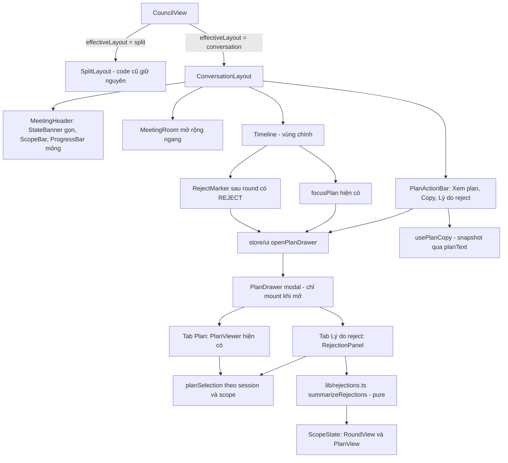

# Plan v3 (đầu ra PlanCouncil, nguyên văn) — Conversation-first UI + tổng hợp lý do reject

> Bản gốc do PlanCouncil sinh ra (3 vòng, chưa hội tụ). Bản tối ưu: `conversation-first-ui.md`.

## 1. Overview
<!-- reviewers: all -->

**Mục tiêu.** Đổi màn hình cuộc họp sang dạng ưu tiên hội thoại, với ba thay đổi:

1. **Hội thoại chiếm phần lớn màn hình.** `MeetingRoom` và `Timeline` trở thành vùng chính. Bỏ cột plan luôn hiển thị.
2. **Plan chỉ hiện khi người dùng mở.** Plan mở trong drawer để xem, copy hoặc export. Drawer bọc `PlanViewer` hiện có, không viết lại.
3. **Có chỗ tổng hợp lý do reject theo từng phiên bản**, ví dụ "v3 bị reject vì sao". Lịch sử được giữ đủ theo từng vòng review.

**Hiện trạng** (theo research notes):
- `CouncilView.tsx` (dòng 15, 42–63) dùng lưới `grid-cols-[minmax(440px,2fr)_3fr]`. Cột phải luôn render `<PlanViewer scope resolve/>`.
- `Timeline` nằm cuối cột trái hẹp, dưới `StateBanner`, `PromptPanel`, `ScopeBar`, `MeetingRoom`, `MemberControls` và `ProgressBar`.
- `sectionStatus.ts:75` đã lọc `verdict === "REJECT"`. `session.ts:520` đã đổi summary thành bong bóng approve/reject.

**Mô hình dữ liệu nguồn:**
- Hàm tổng hợp đọc dữ liệu đã qua reducer trong `ScopeState`: `RoundView[]` (mỗi round có `planVersion` và `slots` theo role) và `PlanView[]`. Hàm không đọc kiểu IPC.
- Nội dung plan luôn đọc qua `planText(session, scopeId, plan)`, vì markdown đang stream nằm trong `SessionState.drafts`.
- Mọi ánh xạ field của slot nằm trong một adapter duy nhất (mục 3.3). Tên field chính xác sẽ được chốt ở Bước 0.

**Bước 0 bắt buộc.** Trước khi code UI phải xác minh code hiện có, khoảng 1 ngày (mục 4). Những điểm chưa xác minh đều đã có sẵn phương án dự phòng trong plan này. Plan không cam kết hành vi nào phụ thuộc vào phần code chưa đọc được.

**Giả định:**
- Chỉ đổi frontend (`src/`). Không đổi IPC, `models.rs` hay orchestrator. Không có API mới, nên quy định versioning/OpenAPI không áp dụng.
- `PlanView` không có thời điểm tạo hay cách revise. Plan này không hiển thị hai thông tin đó.
- Tổng hợp reject áp dụng cho scope đang chọn trong `ScopeBar`.
- Phiên mở từ History **chỉ được hỗ trợ khi Bước 0 xác nhận** dữ liệu khôi phục có đủ review. Nếu thiếu, panel hiện trạng thái "không khả dụng" (mục 5).
- Không thêm thư viện hay dịch vụ trả phí. Chỉ dùng `motion`, `lucide-react`, Tailwind v4 và `zustand` có sẵn.

**Tuân thủ company context:** có feature flag và kế hoạch rollback (mục 5). Stack là React 19 + TypeScript + Tailwind. Không đụng tới dữ liệu cá nhân hay hạ tầng.

## 2. Architecture
<!-- reviewers: frontend_dev, ui_ux_designer -->

### Cây component mới



### Bố cục `ConversationLayout`
<!-- reviewers: ui_ux_designer, frontend_dev -->

**Ở chiều rộng ≥ 1100px:**
- **Header** cao khoảng 56px:
  - `StateBanner` gọn trên một dòng: trạng thái và vòng N/max.
  - `ScopeBar` nằm cùng hàng.
  - `ProgressBar` mỏng 4px ở mép dưới.
- **`MeetingRoom`** rộng toàn bộ, cao khoảng 34vh, tối đa 320px:
  - Bong bóng thoại lớn hơn hiện tại.
  - Người đang nói được highlight, các nhân vật còn lại hơi mờ.
- **`Timeline`** chiếm phần còn lại, cột nội dung rộng tối đa 860px:
  - Mỗi tin có avatar lấy từ `PixelCharacter`, tên kèm màu role.
  - Tin mới vào bằng fade/slide của `motion`.
  - Khi agent đang stream thì hiện typing indicator.
- **`PlanActionBar`** là thanh sticky phía trên timeline, căn phải, gồm ba nút:
  - `Xem plan · v{n}`.
  - `Copy`.
  - `Lý do reject` kèm badge. Badge đếm **số phiên bản có ít nhất một review REJECT ở bất kỳ vòng nào**.
- **`PromptPanel`** thu thành một dòng sau khi phiên bắt đầu. **`MemberControls`** chuyển vào popover cạnh `ScopeBar`.

**Breakpoint dùng thống nhất cho toàn plan:**

| Chiều rộng | `MeetingRoom` | Drawer |
|---|---|---|
| ≥ 1100px | 34vh | `min(720px, 60vw)` |
| 900–1099px | 24vh | Rộng 100% |
| < 900px | Dải avatar | Rộng 100% |

**Reduced-motion:** mọi animation đi qua `MotionConfig` đã có. Khi bật, chỉ giữ thay đổi màu và opacity.

### `PlanDrawer`
<!-- reviewers: ui_ux_designer, frontend_dev -->

**Drawer là modal.**
- Trượt vào từ phải, phía sau có overlay mờ.
- Timeline vẫn **nhìn thấy nhưng không tương tác được** cho tới khi đóng drawer. Đây là chủ đích (xem Trade-offs).
- Thuộc tính accessibility: `role="dialog"` và `aria-modal="true"`.
- Có focus trap. Nếu Bước 0 xác nhận `Dialog.tsx` có logic tái dùng được thì tách logic đó ra dùng chung. Nếu không, viết hook `useFocusTrap` nhỏ trong `PlanDrawer`.
- Khi đóng, focus trả về phần tử đã mở drawer.
- Phím Esc xử lý theo mục 3.8.

**Tab `Plan`:**
- Render `<PlanViewer scope resolve/>` với hai prop tùy chọn mới: `selectedVersion` và `onSelectVersion`.
- Khi không truyền hai prop này, `PlanViewer` giữ hành vi cũ, nên `SplitLayout` không đổi.
- Drawer không có version picker hay Diff riêng. Final, Diff, copy và export là của `PlanViewer`.

**Tab `Lý do reject`:** render `RejectionPanel`.

**Chỉ mount khi mở**, để không render Markdown/Mermaid liên tục khi stream và tránh render Mermaid trong container rộng 0.

### `RejectionPanel`
<!-- reviewers: ui_ux_designer, frontend_dev -->

**Tóm tắt đầu panel:**
- `{x}/{y} phiên bản bị reject`. Trong đó x là số phiên bản có `everRejected`, y là số phiên bản đã có ít nhất một round review.
- Top 3 section bị nêu nhiều nhất, đếm theo lượt review REJECT có gắn section.

**Danh sách phiên bản**, mới nhất ở trên, mỗi phiên bản là một accordion.

**Header của mỗi phiên bản.** Ví dụ: `v3 · Bị reject · vòng 2: 2 REJECT · 1 APPROVE · 1 ABSTAIN / 4 reviewer`.
- **Mẫu số là tổng số slot của round**, mọi loại đều tính.
- Mỗi loại khác 0 hiện thành số riêng: REJECT, APPROVE, ABSTAIN, Lỗi, Không rõ, Đang chờ.
- Nhãn trạng thái theo mục 3.3:

| Trạng thái | Nhãn hiển thị |
|---|---|
| `rejected` | Bị reject |
| `all_approved` | Tất cả APPROVE ở vòng N |
| `in_progress` | Đang review |
| `inconclusive` | Chưa kết luận |
| `unreviewed` | Chưa review |

- Nhãn "Tất cả APPROVE" chỉ mô tả kết quả của các slot. Panel **không** khẳng định phiên bản đã hội tụ hay đã được duyệt.

**Dòng "Mới nhất theo reviewer"** (`latestByReviewer`): mỗi reviewer một chip màu theo outcome, kèm vòng nguồn, ví dụ `backend_dev: REJECT · vòng 1`.

**Nội dung** nhóm theo round → reviewer. Mọi round của phiên bản đó được giữ nguyên.
- **REJECT:**
  - Summary và critical issues được nhấn mạnh.
  - Suggestions nằm trong mục "Gợi ý", mặc định thu gọn.
  - Chip section.
- **APPROVE / ABSTAIN:** một dòng gọn.
- **Carried-over:** nhãn `giữ APPROVE từ vòng trước`.
- **Lỗi / Đang chờ:** chỉ nhãn trạng thái.
- **Không rõ:** nhãn "Verdict không xác định: {rawVerdict}", kèm nội dung review nếu có.
- **Anomaly:** nhãn "dữ liệu bất thường".

**Chip section.**
- Bấm vào: chọn phiên bản đó và chuyển sang tab Plan.
- Chỉ cuộn tới heading khi Bước 0 xác nhận hai điều: số hiệu section ánh xạ được sang heading qua `lib/sections.ts`, và `PlanViewer` render anchor hoặc id cho heading.
- Nếu không xác nhận được, hoặc không tìm thấy heading ở phiên bản đó: chip vẫn mở phiên bản và hiện toast "Không tìm thấy mục §{n} trong v{n}".

**Liên kết nhanh:**
- `Xem v3`.
- `Xem bản sửa v4`: chỉ hiện khi đã có v4. Liên kết này chỉ mở v4, **không** cam kết mở Diff v3→v4. Người dùng tự dùng Diff có sẵn trong `PlanViewer`. Panel không diễn giải bản sau là bằng chứng các lý do reject đã được xử lý.

**`RejectMarker` trong Timeline:**
- Sau mỗi round có ít nhất một REJECT, chèn thẻ hệ thống `v3 bị reject ở vòng 2 (2 REJECT) — Xem lý do`.
- Bấm vào: gọi `openPlanDrawer("rejections", 3)`.

## 3. Data Flow
<!-- reviewers: frontend_dev, backend_dev -->

### 3.1 Nguồn dữ liệu

- Không có luồng backend mới. `bridge.ts` vẫn nghe `council-event`, reducer trong `store/session.ts` cập nhật `ScopeState` như hiện tại.
- Thành phần mới chỉ đọc `RoundView[]`, `PlanView[]` và `planText()`.
- Không dùng `contracts.ts:221`, vì `versions` ở đó chỉ là số đếm.

### 3.2 Selector

- `selectRejections(sessionId, scopeId)` gọi `summarizeRejections(scope.rounds, scope.plans)`.
- Kết quả memo theo tham chiếu của hai mảng đó, nên không tính lại theo từng token stream (draft nằm ở `SessionState.drafts`).

### 3.3 Thuật toán `summarizeRejections`

Hàm pure, độ phức tạp O(R·S).

**Bước 1. Adapter `toSlotOutcome(role, slot)`** ánh xạ mỗi slot sang một trong sáu loại: `approve`, `reject`, `abstain`, `error`, `pending` (gồm cả đang stream), `unknown` (verdict lạ hoặc thiếu verdict dù slot đã kết thúc).

Adapter luôn giữ `rawVerdict`, `carriedOver` và nội dung review (summary, criticalIssues, suggestions, sections). Khi `carriedOver` đi kèm verdict khác APPROVE: phân loại theo verdict gốc, gắn `anomaly: true`.

**Bước 2. Lịch sử.** Gom theo `planVersion → round → slot`. Giữ mọi outcome của mọi round, không lọc trước và không gộp.

**Bước 3. `roundOutcome`.** Xét theo thứ tự, dừng ở điều kiện đầu tiên khớp:

| Thứ tự | Điều kiện | Kết quả |
|---|---|---|
| 1 | Có ít nhất một `reject` | `rejected` |
| 2 | Còn slot `pending` | `in_progress` |
| 3 | Có ít nhất 1 slot và **mọi** slot là `approve` (kể cả carried-over không anomaly) | `all_approved` |
| 4 | Còn lại: có `abstain`, `error`, `unknown`, anomaly, hoặc round không có slot | `inconclusive` |

Quy tắc này **không** tái hiện logic hội tụ của orchestrator. Nó chỉ mô tả kết quả các slot.

**Bước 4. Các trường của mỗi phiên bản:**
- `currentStatus`: `roundOutcome` của round gần nhất review phiên bản đó. Nếu phiên bản chưa có round nào thì là `unreviewed`.
- `latestByReviewer`: với mỗi role, lấy slot ở round lớn nhất mà role đó có slot `kind ≠ pending`, kèm số round nguồn. Nếu role chỉ có slot pending thì lấy pending.
- `everRejected`: bằng true nếu bất kỳ round nào có `reject`. Badge và `RejectMarker` dùng cờ này.

**Bước 5. Predicate `isReject`.** Tách thành hàm dùng chung với `sectionStatus.ts:75`.

### 3.4 Trạng thái UI (`store/ui.ts`, zustand)

```ts
layoutPreference: "auto" | "conversation" | "split";   // persist (mục 5)
planDrawer: { open: boolean; tab: "plan" | "rejections"; expanded: number[];
              opener: HTMLElement | null };             // không persist
planSelection: Record<`${sessionId}:${scopeId}`, number | "latest">; // không persist
openPlanDrawer(tab, version?): void;
closePlanDrawer(): void;
```

Ràng buộc: `planSelection` khóa theo `sessionId:scopeId`. Đổi `sessionId` → đóng drawer, xóa `planSelection` và `expanded`. Đổi scope → drawer giữ tab, đọc key scope mới (mặc định `"latest"`), reset `expanded`.

### 3.5 Copy plan

- Một hook `usePlanCopy` dùng chung cho `PlanActionBar` và `PlanViewer` (tách handler có sẵn nếu có).
- Luôn gọi `planText(session, scopeId, plan)` tại thời điểm bấm.
- Phiên bản đang stream thì `Copy` bị disable, tooltip "Plan đang được viết".
- `navigator.clipboard.writeText`, lỗi thì fallback textarea ẩn + `execCommand("copy")`, báo bằng toast.

### 3.6 Hiển thị plan khi đang stream

- Drawer kế thừa nguồn dữ liệu của `PlanViewer` (sửa đọc qua `planText()` nếu chưa).
- Selection `"latest"` tự theo phiên bản mới nhất; đã chọn cụ thể thì giữ và hiện chip `Có v{n+1} mới`.

### 3.7 Nối `focusPlan` và các lối mở plan

- Liệt kê mọi call site `focusPlan` ở Bước 0.
- Ở layout `conversation`, `focusPlan(scopeId, version)` trong một lần `set`: đặt scope, gán `planSelection`, mở drawer (`tab: "plan"`, `opener: document.activeElement`).
- Ở layout `split`, giữ hành vi cũ. `RejectMarker`, `PlanActionBar`, chip section đều đi qua `openPlanDrawer`.

### 3.8 Phím Esc và lớp chồng

- Một lần Esc chỉ đóng lớp trên cùng. Drawer bắt Esc trên phần tử gốc, `preventDefault` + `stopPropagation`.
- Handler Esc của hộp xác nhận dừng họp thêm guard `if (ui.planDrawer.open && !confirmOpen) return;`.
- Hộp xác nhận mở chồng lên drawer thì Esc đóng hộp xác nhận trước.

## 4. Tech Stack & Schema
<!-- reviewers: frontend_dev, backend_dev -->

- React 19, TypeScript strict, Tailwind v4, `zustand`, `motion`, `lucide-react`. Không thêm dependency. Unit test `vitest` trong `src/lib/*.test.ts`.

### Bước 0 — xác minh code hiện có (trước khi code UI)

| Kiểm tra | Nếu đạt | Nếu không đạt |
|---|---|---|
| `PlanViewer`: nguồn nội dung, handler copy, cách chọn version, Final/Diff/export | Thêm prop `selectedVersion`/`onSelectVersion` | Lift state chọn version ra khỏi component |
| `PlanViewer` render id/anchor cho heading; `lib/sections.ts` ánh xạ số hiệu → heading | Bật cuộn tới heading | Chip chỉ mở phiên bản + toast |
| `Dialog.tsx` có focus trap tái dùng được | Tách ra dùng chung | Viết `useFocusTrap` trong `PlanDrawer` |
| Mọi call site của `focusPlan` | Nối theo 3.7 | — |
| Đường mở phiên History có `rounds[].slots` đủ verdict và nội dung | Hỗ trợ History | Panel "không khả dụng" |
| Vị trí handler Esc của xác nhận dừng họp | Thêm guard | — |
| Cơ chế lưu của `store/ui.ts` (theme, reduced-motion) | Dùng chung | — |

Thứ tự: PR 1 layout + drawer + `focusPlan` + copy; PR 2 `rejections.ts` + `RejectionPanel` + `RejectMarker`.

### File thay đổi / thêm

`CouncilView.tsx` (sửa), `ConversationLayout.tsx` (mới), `PlanDrawer.tsx` (mới), `PlanViewer.tsx` (sửa), `PlanActionBar.tsx` (mới), `RejectionPanel.tsx` (mới), `Timeline.tsx` (sửa), `MeetingRoom.tsx` (sửa), `lib/rejections.ts` + test (mới), `lib/sectionStatus.ts` (sửa), `hooks/usePlanCopy.ts` (mới/tách), `config/layoutFlags.ts` (mới), `store/ui.ts` (sửa), handler xác nhận dừng họp (sửa), Settings › Chung (toggle bố cục).

### Kiểu dữ liệu client (không đổi IPC)

```ts
export type SlotOutcomeKind = "approve" | "reject" | "abstain" | "error" | "pending" | "unknown";
export type RoundOutcome = "rejected" | "in_progress" | "all_approved" | "inconclusive";
export type VersionStatus = RoundOutcome | "unreviewed";
export interface SlotOutcome { role: string; kind: SlotOutcomeKind; rawVerdict?: string; carriedOver: boolean;
  anomaly: boolean; summary?: string; criticalIssues: string[]; suggestions: string[]; sections: string[]; }
export interface RoundEntry { round: number; outcome: RoundOutcome; slots: SlotOutcome[];
  counts: Record<SlotOutcomeKind, number>; total: number; }
export interface VersionRejection { version: number; currentStatus: VersionStatus; everRejected: boolean;
  latestByReviewer: { role: string; round: number; outcome: SlotOutcome }[]; rounds: RoundEntry[]; }
export interface RejectionSummary { versions: VersionRejection[]; rejectedVersionCount: number;
  reviewedVersionCount: number; topSections: { section: string; count: number }[]; }
export function isReject(o: SlotOutcome): boolean;
export function summarizeRejections(rounds: readonly RoundView[], plans: readonly PlanView[]): RejectionSummary;
```

Backend cần xác nhận: nghĩa của `carried_over`; `RoundView.planVersion` trỏ đúng phiên bản; danh sách verdict hợp lệ.

### Test bắt buộc

`summarizeRejections`: toàn APPROVE; REJECT rồi APPROVE cùng version (giữ lý do vòng 1); APPROVE+ABSTAIN → inconclusive; APPROVE+error/unknown → inconclusive; round rỗng; pending ± reject; verdict lạ; carried-over hợp lệ / anomaly; `latestByReviewer` khi reviewer vắng vòng sau; version chưa review; review không có sections; `isReject` khớp logic cũ. `store/ui`: đổi session, đổi scope, `focusPlan` 1 lần cập nhật. `usePlanCopy`: đang stream → disabled; xong → copy đúng `planText`.

Checklist thủ công (live + History): Xem vN từ scope khác; đổi scope/phiên khi drawer mở; Final/Diff/export; focus trap; Esc chồng lớp; reduced-motion; 3 cấu hình flag.

## 5. Edge Cases & Trade-offs
<!-- reviewers: all -->

Edge cases: chưa có plan; plan đang stream; chưa có reject; phiên History thiếu review; round đang chạy; reviewer lỗi / verdict lạ; chưa có version kế tiếp; không tìm thấy section; plan nhiều Mermaid; clipboard bị từ chối; Timeline hàng trăm tin (không virtualize); phiên kết thúc/huỷ.

Trade-offs: drawer modal (đơn giản, nhưng không tương tác timeline khi mở); bọc `PlanViewer` nguyên vẹn; bỏ link diff cố định v3→v4; trạng thái theo slot, không theo logic hội tụ; tổng hợp ở client; giữ `SplitLayout` song song để rollback.

Feature flag: `src/config/layoutFlags.ts` — `LAYOUT_DEFAULT = "conversation"`, `LAYOUT_FORCE: "split" | null = null`. `layoutPreference` lưu bằng cơ chế localStorage hiện có của `store/ui.ts`, key `plancouncil.layout`. `effectiveLayout = LAYOUT_FORCE ?? (layoutPreference === "auto" ? LAYOUT_DEFAULT : layoutPreference)`. Rollback: người dùng chọn Chia đôi; hotfix `LAYOUT_DEFAULT = "split"`; hotfix `LAYOUT_FORCE = "split"`. Test ma trận 3×3. Gỡ `SplitLayout` sau 2 release.

Out of scope: đổi IPC/models/orchestrator/prompt/hội tụ; bổ sung dữ liệu History; thời điểm tạo/cách revise; diff cố định v3→v4; panel non-modal; tóm tắt reject bằng LLM; export/chia sẻ mới; phím tắt mở drawer; version picker riêng; virtualization; theme/asset/âm thanh mới; i18n; component test tự động; Settings ngoài toggle bố cục.

## 6. Changelog (v2 → v3)

16 mục (History qua Bước 0; `all_approved` chặt; kind `unknown`; `latestByReviewer`; `planSelection` theo session; `focusPlan`; bỏ cam kết diff; cuộn heading có điều kiện; Esc; mẫu số; breakpoint; drawer modal; bỏ khẳng định chưa kiểm; persist dùng cơ chế cũ; checklist thủ công (Partially fixed); chia PR).
